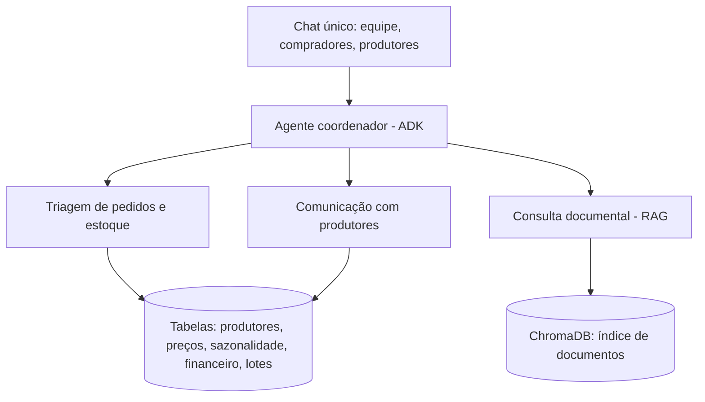

# Assistente Inteligente Sabor da Terra

> **Projeto acadêmico com cenário fictício.** A cooperativa, os produtores, os compradores e todos os dados deste repositório são **sintéticos**. Nenhuma pessoa ou empresa real é representada.
> **Status:** em desenvolvimento (protótipo de 12 dias, 2 sprints). Prontos: exploração dos dados, limpeza, ingestão e busca do RAG (30 testes; ChromaDB e Gemini validados em 15/11; falta calibrar o limiar). Itens marcados com `TODO` ainda não existem.

Agente de IA para uma cooperativa de agricultura familiar do Agreste Pernambucano. Um único chat atende a equipe, os compradores e os produtores, e resolve três problemas que hoje são manuais.

## Problemas e solução

| Problema | Módulo do agente | Resultado esperado |
|---|---|---|
| Triagem diária de pedidos em linguagem natural (e-mail, WhatsApp, formulário), com informação incompleta ou regional | **Triagem de pedidos e estoque** | extrai produto, quantidade, prazo e comprador; cruza com safra, preço e produtor; classifica urgência |
| Horas gastas procurando informação em laudos, certificações, fichas e contratos | **Consulta documental (RAG)** | resposta com **fonte exata** do documento e sem inventar |
| Falta de canal com os produtores sobre vendas, safras e pendências | **Comunicação com produtores** | extratos e avisos em linguagem simples, só com os dados do próprio produtor |

## Arquitetura (planejada)



- **Modelo e orquestração:** Gemini + Agent Development Kit (ADK), conforme o plano do grupo. `TODO` registrar versões usadas.
- **RAG:** índice **ChromaDB** gerado no build e empacotado na imagem do Cloud Run. Decisão e alternativas em [`docs/decisoes.md`](docs/decisoes.md).
- **Deploy:** Cloud Run. `TODO` link e comando de deploy.

## Dados e privacidade

- Os dados simulados incluem armadilhas intencionais (certificação vencida, produtor sem registro sanitário, lote inexistente, preço divergente, pedido pedindo CPF). O levantamento completo está em [`docs/exploracao-dados.md`](docs/exploracao-dados.md).
- **Tratamos os dados como se fossem reais (LGPD):** CPF, PIX, conta, telefone, e-mail, endereço e data de nascimento não entram no índice vetorial; as tabelas são consultadas por ferramenta com lista de colunas permitidas; o agente recusa e escala pedidos de dados pessoais ou bancários.
- Mascaramento implementado em `sabor/mascara.py` (CPF, CEP, e-mail, telefone, dados bancários, PIX, RG, nascimento). A ingestão **falha** se sobrar dado pessoal. Ver [`docs/pipeline-rag.md`](docs/pipeline-rag.md).

## Estrutura do repositório

```
.
├── COMECE-AQUI.md              # passo a passo para rodar no seu computador
├── README.md
├── requirements.txt            # pandas, numpy
├── requirements-rag.txt        # chromadb, google-genai
├── data/
│   ├── raw/                    # CSV e pedidos.json (originais, intocados)
│   ├── clean/                  # tabelas limpas, sem dados pessoais (gerado)
│   ├── documentos/             # base do RAG (sem duplicatas)
│   └── index/                  # índice vetorial (gerado pela ingestão)
├── sabor/                      # pipeline: limpeza, mascaramento, chunking, embeddings, índice, busca
├── evalset/                    # gabarito dos 15 pedidos (json) para o QA
├── tests/                      # 30 testes (rodam sem rede)
├── scripts/
│   ├── explorar_dados.py       # checagens dos CSV/JSON (pandas)
│   ├── testar_ambiente.py      # confirma ChromaDB e Gemini na sua máquina
│   └── calibrar_limiar.py      # escolhe o limiar de relevância com perguntas reais
├── docs/
│   ├── exploracao-dados.md     # o que está errado, estranho ou escondido nos dados
│   ├── pipeline-rag.md         # pipeline do RAG, ferramentas do agente e limites
│   ├── gabarito-pedidos.md     # o que o agente deve e não deve fazer em cada pedido
│   ├── resumo-apresentacao-rag.md  # uma página para a apresentação
│   ├── decisoes.md             # decisões de arquitetura (ChromaDB) e alternativas
│   ├── relatorio-varredura.md  # conferência de fatos, pendências e próximos passos
│   └── referencia/             # PDF de arquitetura do grupo
└── agent/                      # TODO: código do agente (ADK)
```

## Como executar

```bash
# exploração dos dados
pip install -r requirements.txt
python scripts/explorar_dados.py data/raw docs/saida-exploracao.txt

# pipeline do RAG (detalhes em docs/pipeline-rag.md)
pip install -r requirements-rag.txt
python scripts/testar_ambiente.py
python -m sabor.limpeza
python -m sabor.ingestao --embedder gemini --backend chroma   # precisa de GEMINI_API_KEY
python -m unittest discover -s tests -t . -v
```

`TODO` instruções do agente local e do deploy.

## Avaliação

`TODO` conjunto de testes com os 15 pedidos simulados (acerto de trajetória de ferramentas, fidelidade às fontes do RAG, ausência de alucinação, testes de prompt injection). Os resultados entram aqui com data e versão.

## Limitações conhecidas

- Corpus pequeno (cerca de 20 documentos) e estático: o índice só muda com novo build e novo deploy.
- Referências legais nos documentos podem estar desatualizadas (ex.: percentual mínimo do PNAE); o agente cita o documento e sinaliza a divergência.
- `TODO` limitações observadas na avaliação.

## Próximos passos

- Migrar o índice para pgvector no Cloud SQL se o corpus crescer ou precisar de atualização contínua.
- `TODO` demais itens após a avaliação.

## Equipe

Seis integrantes com papéis de Scrum Master e prompts, Product Owner e triagem, dados e RAG, orquestração ADK, nuvem e interface, e QA. `TODO` nomes e links, a critério do grupo.
