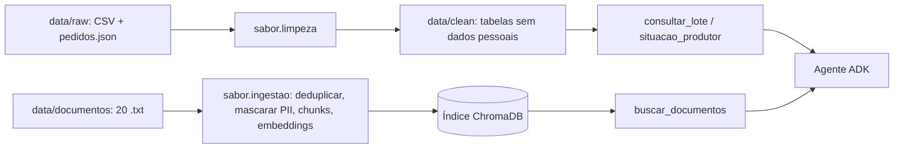

# Pipeline de dados e RAG (Integrante 3)

**Status:** implementado e validado com ChromaDB e Gemini reais (15/11/2026). Falta calibrar o limiar de relevância (ver "O que foi e o que não foi testado").

## Visão geral



## Como rodar (Windows, na pasta do projeto)

```
py -m pip install -r requirements.txt
py -m pip install -r requirements-rag.txt
py scripts\testar_ambiente.py
py -m unittest discover -s tests -t . -v
py -m sabor.limpeza
$env:GEMINI_API_KEY = "sua-chave"
py -m sabor.ingestao --embedder gemini --backend chroma
py scripts\calibrar_limiar.py
```

- `testar_ambiente.py` confirma em 1 minuto se o ChromaDB e o Gemini funcionam na sua máquina.
- Sem chave ou sem Chroma: `py -m sabor.ingestao --embedder offline --backend memory` roda o pipeline inteiro com um embedder lexical (só teste/demo; a qualidade da busca é inferior).
- Se `chromadb` não instalar (o Python 3.14 pode não ter todas as dependências), use o Python 3.12 ou 3.13, ou `--backend memory`.

## Módulos

| Módulo | Função |
|---|---|
| `sabor/limpeza.py` | Gera `data/clean/`: remove CPF, PIX, banco, agência, conta, telefone, e-mail, endereço e nascimento; padroniza nomes de produto; cria `unidade` real; cria `restricoes_produtor.csv` (SIE, DAP/CAF e restrições, com fonte) |
| `sabor/mascara.py` | Mascara dados pessoais nos textos. Mantém CNPJ, nomes, municípios e registros profissionais |
| `sabor/chunking.py` | Divide cada documento por seção, junta seções curtas, quebra longas (máx. 1.400 caracteres) e gera metadados |
| `sabor/embeddings.py` | `GeminiEmbedder` (`gemini-embedding-001`, 768 dimensões, `RETRIEVAL_DOCUMENT` na ingestão e `RETRIEVAL_QUERY` na busca) e `OfflineEmbedder` (testes) |
| `sabor/armazenamento.py` | `ChromaStore` (produção) e `MemoryStore` (testes e plano B), mesma interface |
| `sabor/ingestao.py` | Lê, ignora duplicatas por hash, mascara, **falha se sobrar dado pessoal**, gera chunks e embeddings, grava índice e `index_info.json` |
| `sabor/busca.py` | Ferramenta `buscar_documentos` |
| `sabor/dados.py` | Ferramentas `consultar_lote` e `situacao_produtor` |
| `sabor/produtores.py` | Ferramenta `extrato_produtor(produtor_id, solicitante, periodo, data_referencia)`: extrato do produtor em linguagem simples; nega acesso a quem não é o próprio produtor nem a diretoria |

## Ferramentas para o agente (ADK)

Funções Python simples, com docstring em português e retorno em `dict` com `status`. A ideia é passá-las em `tools=[...]` do ADK; **confirmar com o Jorge** na versão usada.

| Ferramenta | Para quê | Retorno |
|---|---|---|
| `buscar_documentos(consulta, tipo="", produtor_id="", valido_em="", k=5)` | selo orgânico, SIE, contratos, fichas | `ok` com trechos e **fonte** (arquivo e seção), `nao_encontrado` ou `erro` |
| `consultar_lote(lote_id)` | rastreabilidade de um lote | detalhes e alertas; se não existir (`2024-089`), `nao_encontrado` com sugestão (`LOT-2026-0089`) só para confirmar |
| `extrato_produtor(produtor_id, solicitante, periodo="", data_referencia="")` | extrato de vendas e pagamentos | `ok` com resumo, vendas, alertas e `mensagem_simples`; `negado` se o solicitante não for o produtor nem "diretoria" |
| `situacao_produtor(produtor_id, data_referencia="")` | selo vigente/vencido/vence em breve, SIE, DAP/CAF, restrições | situação calculada pela validade (a coluna "sim/não" do cadastro não basta) e `alertas` |

**Para o Jorge:** o índice é lido de `SABOR_INDEX_DIR` (padrão `data/index`). O embedding da pergunta é gerado em tempo de execução, então o agente publicado precisa de `GEMINI_API_KEY` (Secret Manager, com o Isaque). A data de referência vem de `SABOR_DATA_REFERENCIA` (AAAA-MM-DD) ou do dia de hoje.

## Decisões

- **Mascarar antes de indexar.** CPF, PIX, conta, telefone e e-mail nunca entram no índice nem nas respostas (telefones de empresas também, por simplicidade). Perguntas por esses dados devem ser escaladas a um humano.
- **Metadados:** `arquivo, tipo, titulo, secao, produtor_id, produtores, validade_ate, validade_tipo`. Datas como inteiro `AAAAMMDD` e listas como texto `|P003|P007|` (o Chroma só aceita valores simples; o filtro por produtor é refeito em Python).
- **Validade calculada na consulta** com a data de referência. Documento vencido não é escondido: volta com `situacao_validade: "vencido"`.
- **Citação obrigatória:** todo resultado traz `fonte` e `secao`. Sem resultado acima do limiar, o retorno é `nao_encontrado`.
- **A busca recusa embedder diferente do usado na ingestão** (modelo ou dimensão).

## O que foi e o que não foi testado

**Testado (30 testes, sem rede):** mascaramento (e idempotência), chunking dos 20 documentos reais, validade de certificados e contratos, deduplicação, ausência de CPF/PIX/conta no índice, busca com filtros, `nao_encontrado`, recusa de embedder incompatível, limpeza sem colunas pessoais, lote inexistente com sugestão, alertas de lote, situação de produtor, extrato de produtor (acesso próprio, negado a terceiros, sem dado pessoal).

**Validado na máquina do Integrante 3 em 15/11/2026 (Windows, Python 3.14):** os 30 testes; `ChromaStore` real (similaridade, filtro de igualdade, filtros combinados, índice gravado e relido); limpeza e ingestão ponta a ponta com ChromaDB (20 documentos, 33 chunks, 36 dados pessoais mascarados); `GeminiEmbedder` (`gemini-embedding-001`, 768 dimensões; exemplo relevante 0,697 x irrelevante 0,538).

**Ainda falta:**
1. ~~Calibrar o limiar~~ **Feito em 15/11/2026** (`scripts/calibrar_limiar.py`, 10 perguntas com resposta e 6 sem). Perguntas com resposta: 0,707 a 0,785, e todas acharam o documento certo. Perguntas fora do assunto: 0,514 a 0,586. O padrão ficou em **0,65** (ponto médio). Exceção: "Qual o CPF do produtor P001?" marcou 0,696, por ser do mesmo assunto dos documentos; isso **não se resolve com limiar**. O CPF não está no índice (mascarado na ingestão), e a recusa de dados pessoais deve estar no prompt do agente. Ajuste sem mexer no código: `$env:SABOR_LIMIAR = "0.65"`. Reavaliar com o `evalset` do Integrante 6.
2. Conferir com o Jorge o deploy no Cloud Run (a pasta do índice na imagem; a chave do Gemini via Secret Manager).
3. Avaliar a qualidade da busca com o `evalset` do Integrante 6.

## Limites conhecidos

- Mudar documentos exige nova ingestão e novo deploy (decisão D-001).
- O mascaramento usa padrões (regex); formatos novos exigem ajuste em `mascara.py`. A ingestão falha se sobrar CPF, e-mail, telefone ou dados bancários.
- Validade de laudos ("6 meses") e de documentos sem data explícita não é extraída: ficam como `sem_validade_definida`.
- `restricoes_produtor.csv` combina o que está nos documentos com regras manuais que citam a fonte; produtores sem informação aparecem como `desconhecido`.
